```mermaid
flowchart TD
    subgraph Core ["Yagona Server (Django + Gunicorn + PostgreSQL/SQLite)"]
        Router["URL Router & Domain Dispatcher"]
        ERP["Mini Bot ERP & Cross-Product Switcher"]
    end

    subgraph P1 ["1. Restoran 3D/AR Menyu (Mustaqil Mahsulot)"]
        P1_Web["Web: /menu/ (3D AR Menyu)"]
        P1_Bot["Bot: @marketing_orign_bot (TMA Menyu)"]
        P1_Admin["Admin: Stollar & Kassa (/seller/tables/)"]
        P1_Hardware["NFC Kartalar & QR Stendlar"]
    end

    subgraph P2 ["2. Online Store Guliston (Marketplace)"]
        P2_Web["Web: / (Katta Gipermarket)"]
        P2_Bot["Bot: E-Commerce Shopping Bot"]
        P2_Admin["Admin: Sotuvchilar & Sklad (/seller/)"]
        P2_Logistics["Kuryerlar & Geo Xarita"]
    end

    subgraph P3 ["3. 3D Studio & Servis Markazi (Chop etish & Muhandislik)"]
        P3_Web["Web: /studio/ (3D Kalkulyator)"]
        P3_Bot["Bot: 3D File Upload & Print Bot"]
        P3_Admin["Admin: Print Queue & Filament Ombori"]
        P3_Hardware["3D Printerlar & Telemetriya"]
    end

    Router --> P1_Web
    Router --> P2_Web
    Router --> P3_Web

    ERP -.-> P1
    ERP -.-> P2
    ERP -.-> P3
```

# TEXNIK VAZIFA (TZ): 3 TA MUSTAQIL MAHSULOT VA 3 TA TELEGRAM BOT EKOTIZIMI
**Loyiha:** Online Store Guliston & Multi-Product Ecosystem  
**Sana:** 28.09.2026  
**Muallif:** Google Deepmind Agentic Architecture  
**Holat:** TASDIQLANGAN (Arxitekturaviy Reja va Bajarish Bosqichlari)

---

## 📌 KIRISH VA STRATEGIK MAQSAD

Loyiha bitta umumiy serverda ishlaydigan, biroq arxitektura jihatidan **bir-biridan to'liq mustaqil (loosely coupled modular monolith)** 3 ta yirik mahsulotga ajratiladi:

1. **Mahsulot #1: Restoran 3D/AR Menyu & Telegram Bot (TMA)** — Restoran, kafe va choyxonalar uchun avtonom 3D stol menyusi, NFC/QR xizmati, ofitsiant va biznes egasi stollar monitoringi tizimi. Boshqa saytlardan to'liq uzilgan holda alohida restoranlarga mustaqil sotiladi.
2. **Mahsulot #2: Online Store Guliston & E-Commerce Bot** — Katta onlayn gipermarket, ko'p sotuvchili (multi-vendor) marketplace, kuryerlik logistikasi, tovarlar ombori va mijozlar xaridi.
3. **Mahsulot #3: 3D Studio & Xizmatlar Markazi & 3D Print Bot** — 3D printerda buyurtma asosida ehtiyot qismlar, maketlar va suvenirlar chop etish, SAPR/3D modellashtirish va muhandislik xizmatlari portali.

Har bir mahsulot quyidagi 4 ta ustunga ega bo'ladi:
* **Alohida Web UI / Link** (bitta serverda alohida marshrut yoki subdomen bilan).
* **Alohida Telegram Bot & Mini App (TMA)** (har bir yo'nalish o'zining ixtisoslashgan botiga ega).
* **Alohida Boshqaruv / Admin Paneli** (o'zining analitikasi, sozlamalari va operatsion jadvallari bilan).
* **Mini Bot ERP Qatlami** (mustaqil ishlash bilan birga, yagona adminda 1-klikda o'tish switcheri).

---



---

## 🍽 TZ-1: RESTORAN 3D/AR MENYU & TELEGRAM BOT (MAHSULOT #1)

### 1.1. Maqsad va Xususiyatlar
* Restoran va choyxonalarga **mustaqil SaaS yechim** sifatida sotiladi.
* Agar tizimdan boshqa 2 ta sayt (Marketplace va 3D Studio) uzib tashlansa ham, Restoran 3D Menyu va uning boti hech qanday xatoliksiz, 100% avtonom ishlaydi.
* E-commerce elementlaridan to'liq tozalangan: savatcha o'rniga — **Stol buyurtmasi**, xarid o'rniga — **Oshxonaga yuborish**, manzil kiritish o'rniga — **Stol №...**.

### 1.2. Web & Mini App Dizayni (UI/UX)
* **URL Marshruti:** `/menu/` (yoki `/tma/`). Stol bilan kirganda: `/menu/?table=1` yoki NFC/QR token: `/menu/?t=<token>`.
* **Ranglar Palitrasi:** Luxury Dark-Gold (`#0f172a`, `#1e293b`, `#f59e0b`).
* **3D AR Model Viewer:** Har bir milliy taom uchun 360° aylanuvchi 3D model, Google WebXR orqali smartfon kamerasida stol ustiga qo'yib ko'rish.
* **Pastki Menyu (Bottom Navigation):**
  1. `🍽 Menyu` — 3D taomlar vitrinasi va toifalar.
  2. `🍲 Bo'limlar` — Milliy taomlar, Kaboblar, Somsalar, Salatlar, Ichimliklar filtri.
  3. `🥽 3D AR` — Interaktiv 3D zal va 3D taomlar ko'rgazmasi.
  4. `🧾 Buyurtma` — Stol buyurtmasi ro'yxati, hisob varaqasi, Click/Payme/Naqd to'lov.
  5. `📍 Stolim` — Stol statusi, ofitsiantni chaqirish (🫖 Choy, 🍞 Non, 🔔 Xodim, 🧾 Hisob).

### 1.3. Telegram Bot Funksiyalari
* **Mehmonlar uchun:**
  * Stol QR/NFC orqali kirganda: `/start table_5` -> avtomatik 5-stolga ulanish.
  * 3D AR Menyuni Mini App ko'rinishida ochish.
  * Buyurtma tasdiqlanganda Telegram orqali chek olish.
* **Biznes Egasi va Ma'murlar uchun:**
  * `/stollar` — Bugungi barcha stollar holati: jami stollar, bo'sh va band stollar, har bir stolda nimalar buyurtma qilingani va qancha tushum bo'lgani.
  * `/kassa` — Bugungi umumiy restoran tushumi, xarajatlar va sof kassa.
  * Callback boshqaruvi: `t_set_free:<id>` (stolni bo'shatish), `t_set_occ:<id>` (stolni band qilish).
* **Oshxona & Ofitsiant integratsiyasi:**
  * Yangi buyurtma tushganda ofitsiant va oshxona guruhiga taomlar ro'yxati bilan tezkor xabar.

### 1.4. Boshqaruv Paneli (`/seller/tables/` va `/seller/telegram/`)
* **Zal va Stollar xaritasi:** Zallar (1-qavat, 2-qavat, VIP xona), stollar koordinatasi, NFC kartalar biriktirish, QR kod stendlarini PDF chop etish.
* **Jonli Telegram Chat Tarixi (`/seller/telegram/`):**
  * Botga kelgan har bir mijoz xabari, buyruqlari (`/start`, `/stollar`, `/kassa`) va botning qaytargan javoblari real vaqtda jadvalda ko'rinadi.
  * Mijozga bevosita admin panelidan javob yozish yoki ruxsat berish.

---

## 🛍 TZ-2: ONLINE STORE GULISTON (MARKETPLACE) (MAHSULOT #2)

### 2.1. Maqsad va Xususiyatlar
* Shahar miqyosidagi yirik gipermarket va ko'p sotuvchili onlayn bozor.
* Bir nechta do'konlar (oziq-ovqat, kiyim-kechak, elektronika, maishiy kimyo va b.) bitta savatga tovar qo'shishi va kuryer orqali yetkazib berilishi mumkin.

### 2.2. Web & Mini App Dizayni
* **URL Marshruti:** `/` (Asosiy sayt), `/shop/<slug>/` (Do'kon sahifasi), `/cart/`, `/checkout/`.
* **Dizayn:** Clean Modern E-Commerce (`#ffffff`, `#f8fafc`, `#2563eb`).
* **Savat & Checkout:** Yetkazib berish manzili, xaritada lokatsiya tanlash, kuryerlik tarifi (masofaga qarab hisoblash), kupon/promo-kodlar.

### 2.3. Telegram Boti
* **E-Commerce Shopping Bot:**
  * Tovar qidiruv (nomi yoki shtrix-kod orqali).
  * Do'konlar katalogi va toifalar bo'yicha filter.
  * Buyurtma statusi kuzatuvi (`Kutilmoqda` -> `Qadoqlanmoqda` -> `Kuryer yo'lda` -> `Yetkazildi`).
  * Geolokatsiyani Telegram orqali yuborish (`Send Location`).

### 2.4. Boshqaruv Paneli (`/seller/` va `/admin/`)
* Sotuvchilar kabineti: Tovarlar qoldig'i (sklad hisobi), narxlar, chegirmalar.
* Kuryerlar boshqaruvi: Buyurtmani kuryerga biriktirish, yetkazib berish marshruti.
* Moliya: Savdo aylanmasi, platforma komissiyasi, Click/Payme hisob-kitoblari.

---

## 🖨 TZ-3: 3D STUDIO & SERVISLAR MARKAZI (MAHSULOT #3)

### 3.1. Maqsad va Xususiyatlar
* Maxsus 3D bosib chiqarish, prototiplash, muhandislik xizmatlari va 3D printerlar sotuvi/servisi.
* Mijoz o'zining 3D modelini (`.stl`, `.obj`, `.step`) yuklaydi va bir necha soniyada aniq narxni hisoblab buyurtma beradi.

### 3.2. Web UI & 3D Narx Kalkulyatori
* **URL Marshruti:** `/studio/` (yoki `/3d-print/`).
* **Dizayn:** High-tech Cyber Dark (`#0b0f19`, `#111827`, `#06b6d4`, `#3b82f6`).
* **Avtomatik Kalkulyator:**
  * 3D Fayl yuklash (drag-and-drop `.stl`, `.obj`).
  * Brauzerda Three.js asosida modelni 3D ko'rish va o'lchamlarini tekshirish ($X \times Y \times Z$ mm).
  * Og'irligi (gramm) va bosib chiqarish vaqtini avtomatik hisoblash.
  * Material tanlash:
    * **PLA** — Standart maketlar va suvenirlar (1 gr = 500 so'm).
    * **PETG** — Mustahkam, issiqlikka chidamli mexanik qismlar (1 gr = 700 so'm).
    * **ABS** — Avtomobil va zarbaga chidamli detallar (1 gr = 800 so'm).
    * **TPU (Flexible)** — Rezinasimon egiluvchan detallar (1 gr = 1 200 so'm).
    * **SLA Resin** — Mikron aniqlikdagi zargarlik/tibbiyot modellari (1 gr = 2 000 so'm).
  * To'ldirish (Infill): 10%, 20%, 50%, 100%.

### 3.3. Telegram Boti (3D Print Assistant)
* Mijoz Telegram orqali fayl jo'natadi -> Bot fayl hajmi va taxminiy narxni hisoblaydi.
* Muhandis bilan to'g'ridan-to'g'ri texnik maslahat chat.
* Chop etish jarayonida (printer ishlayotganda) veb-kamera yoki fotosurat orqali status yuborish.

### 3.4. Boshqaruv Paneli (`/studio/admin/`)
* **Chop etish navbati (Print Queue):** Kutilayotgan, chop etilayotgan va tayyor buyurtmalar kanban doskasi.
* **Printerlar telemetriyasi:** Printer 1 (Bambu Lab), Printer 2 (Creality Ender), Printer 3 (Elegoo Resin) holati.
* **Filament ombori:** Qolgan g'altaklar (kg) va xomashyo hisobi.

---

## 🔄 YAGONA SERVERDA LOOSE COUPLING VA MINI BOT ERP ARXITEKTURASI

### 4.1. URL va Marshrutlash Strukturasi

| Mahsulot | Veb Sahifa | Telegram Mini App | Admin Paneli | Bot Vazifasi |
| :--- | :--- | :--- | :--- | :--- |
| **1. Restoran 3D** | `/menu/` | `/menu/?table=...` | `/seller/tables/` | Stollar, 3D taomlar, ofitsiant chaqirish, kassa |
| **2. Online Store** | `/` | `/tma/` | `/seller/` | Marketplace, savat, kuryer, tovarlar |
| **3. 3D Studio** | `/studio/` | `/studio/tma/` | `/studio/admin/` | 3D model yuklash, narx kalkulyatori, print queue |

### 4.2. Universal Mahsulot Switcher (Headerda)
Har bir saytning yuqori menyusida 3 ta platforma o'rtasida 1-klikda o'tish tugmasi bo'ladi:
```html
[ 🍽 3D Restoran Menyu ]  |  [ 🛍 Online Store ]  |  [ 🖨 3D Studio & Servis ]
```
Shuningdek, Admin panelida biznes egasi bitta tugma bilan Restoran stollaridan Marketplace sotuvlariga yoki 3D chop etish navbatiga o'ta oladi.

### 4.3. Uzib Qo'yish Xavfsizligi (Decoupled Architecture)
* Har bir mahsulot o'zining mustaqil Django App (`tables_restaurant`, `products`, `studio_3d`) va toza servislariga ega bo'ladi.
* Agar Restoran boti boshqa serverga ko'chirilsa, u `shops` va `tables_restaurant` modullarini olib, marketplace logistikasisiz mustaqil ishlayveradi.

---

## 📋 KETMA-KET AMALGA OSHIRISH BOSQICHLARI (ROADMAP)

1. **1-QADAM (Hozirgi ustuvorlik — Restoran 3D Bot & Menyu yakunlash):**
   - [x] Serverni orqa fonda minimal CPU/RAM sarfi bilan ishga tushirish.
   - [x] `/seller/telegram/` da botga kelgan va yuborilgan barcha xabarlarni saqlash va ko'rsatish.
   - [x] Pastki mobil menyuni restoran standartiga o'tkazish (`🍽 Menyu`, `🍲 Bo'limlar`, `🥽 3D AR`, `🧾 Buyurtma`, `📍 Stolim`).
   - [x] `/menu/?table=1` xatosiz, tezkor stol bog'lanishi.

2. **2-QADAM (Online Store Guliston e-commerce botini mustaqillash):**
   - Asosiy marketplaceni toza e-commerce holatida ushlash.
   - Savatcha va kuryerlik oqimini restoran stollaridan alohida saqlash.

3. **3-QADAM (3D Studio & Servislar Markazi sahifasi va kalkulyatori):**
   - `/studio/` sahifasini yaratish.
   - `.stl` / `.obj` 3D yuklash va material bo'yicha narx hisoblash kalkulyatorini ulash.
   - 3D printer buyurtmalar navbati (Print Queue).

4. **4-QADAM (Yagona Switcher va Mini Bot ERP):**
   - Saytlar va Admin panellar o'rtasida o'tish panelini (Switcher) barcha shablonlarga joylashtirish.
   - Botlar orqali boshqaruv buyruqlarini moslashtirish.
