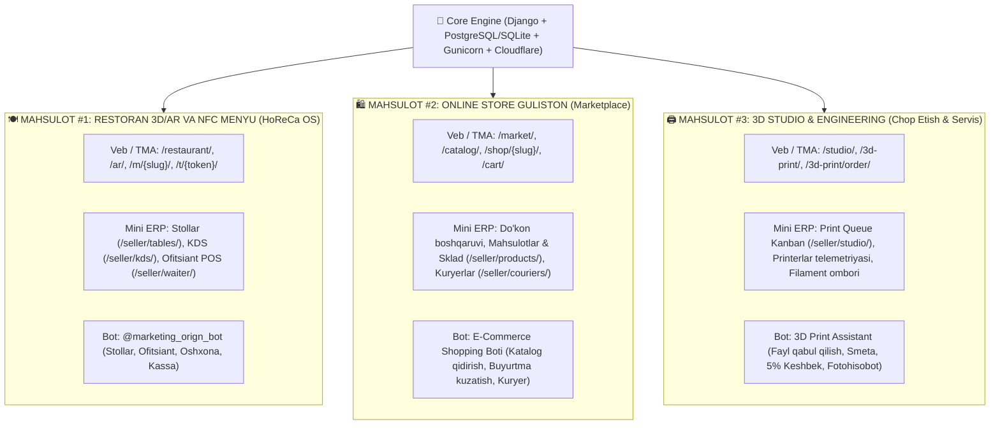

# 🏛 MASTER ECOSYSTEM OVERVIEW: 3 TA MUSTAQIL MAHSULOT
**Loyiha:** Online Store Guliston & Multi-Product Platform  
**Sana:** 01.10.2026  
**Arxitektura:** Modular Monolith with Loose Coupling (3 Independent Businesses on 1 Engine)

---

## 📌 1. Strategik Tuzilma

Ushbu repozitoriy bitta yuqori unumdor Django yadrosida ishlaydigan, biroq biznes mantig'i, foydalanuvchi oqimi, mini ERP va botlari bo'yicha **3 ta to'liq mustaqil mahsulotni** o'z ichiga oladi:

---

## 🧭 2. Mahsulotlar Qiyosiy Matritsasi

| Parametr | 🍽 1. Restoran 3D/AR Menyu | 🛍 2. Online Store (Marketplace) | 🖨 3. 3D Studio & Servis |
| :--- | :--- | :--- | :--- |
| **Fokus & Bozor** | Restoran, kafe, choyxona (B2B SaaS) | Gipermarket, chakana savdo (B2C/B2B) | Muhandislik, 3D prototiplash (On-Demand) |
| **Asosiy URL** | `/restaurant/` (va `/ar/`, `/m/<slug>/`) | `/market/` (va `/catalog/`, `/cart/`) | `/studio/` (va `/3d-print/`) |
| **Asosiy Sahifa (`/`)** | Standart holatda to'g'ridan-to'g'ri Restoran 3D | `/market/` orqali ochiladi | `/studio/` orqali ochiladi |
| **Mini ERP Paneli** | `/seller/tables/`, `/seller/kds/`, `/seller/waiter/` | `/seller/products/`, `/seller/orders/`, `/seller/couriers/` | `/seller/studio/` (Print Queue Kanban) |
| **Telegram Boti** | `TELEGRAM_RESTAURANT_BOT_TOKEN` | `TELEGRAM_MARKET_BOT_TOKEN` | `TELEGRAM_STUDIO_BOT_TOKEN` |
| **Bot Webhook** | `/bot/restaurant/webhook/` (va `/telegram/webhook/`) | `/bot/market/webhook/` | `/bot/studio/webhook/` |
| **Asosiy Valyuta / Narx** | Taom narxi (so'm) | Tovar narxi (so'm) | Gram / Material bo'yicha narx (so'm/gr) |
| **To'lov Modeli** | Naqd / Stolda to'lash (85%), Click/Payme | Click, Payme, Yetkazilganda naqd | Online karta / 5% keshbekli depozit |

---

## 🔀 3. O'zaro Aloqa va Universal Switcher

Sayt foydalanuvchilari va biznes egasi har qanday sahifadan 1-klikda boshqa mahsulotga o'tish imkoniyatiga ega:
* **Header / Navigatsiya:**
  * `[ 🍽 3D Restoran Menyu ]` -> `/restaurant/`
  * `[ 🛍 Onlayn Bozor ]` -> `/market/`
  * `[ 🖨 3D Studio & Print ]` -> `/studio/`
* **Seller / Admin Yon Menyusi (Sidebar):**
  * `🍽 Restoran Stollari & KDS` -> `/seller/tables/`, `/seller/kds/`
  * `🛍 Tovar & Sklad Boshqaruvi` -> `/seller/products/`, `/seller/orders/`
  * `🖨 3D Printer Ustaxonasi` -> `/seller/studio/`

---

## 🛡 4. Ma'lumotlar Izolyatsiyasi (Isolation Rules)

1. **Stol ma'lumotlari:** Faqat `tables_restaurant` moduli va `Order.table` maydoni bilan ishlaydi; Marketplace mahsulotlariga aralashmaydi.
2. **Buyurtma xabarnomalari:** Har bir restoranning buyurtmasi `order.shop_id` bo'yicha qat'iy filtrlanib, faqat o'sha muassasa xodimlariga boradi.
3. **Keshbek va Smetalar:** 3D Studio buyurtmalari alohida `Print3DOrder` jadvalida yuritiladi, umumiy e-commerce buyurtmalari bilan aralashmaydi.
