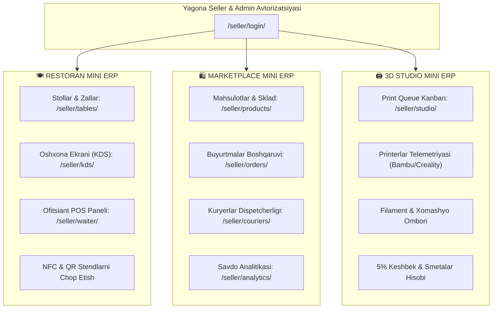

# 🤖 MULTI-BOT VA MINI ERP ARXITEKTURASI
**Loyiha:** Online Store Guliston (3 Ta Mustaqil Mahsulot Ekotizimi)  
**Sana:** 01.10.2026

---

## 📱 1. UCHTA MUSTAQIL TELEGRAM BOTI

Har bir mahsulot o'zining ixtisoslashgan Telegram botiga ega. Botlar bitta umumiy serverda yashaydi, lekin tokenlari va webhook yo'llari alohida (loose coupling).

```
                      Telegram Platform
                     /        |        \
                    /         |         \
   @restaurant_bot         @market_bot   @studio_3d_bot
          |                   |                 |
          v                   v                 v
 /bot/restaurant/webhook/   /bot/market/webhook/   /bot/studio/webhook/
```

### 1.1. Botlar Sozlamalari Jadvali

| Bot Yo'nalishi | Token Kaliti (.env) | Webhook Manzili | Asosiy TMA Yo'li | Vazifasi |
| :--- | :--- | :--- | :--- | :--- |
| **🍽 1. Restoran Boti** | `TELEGRAM_RESTAURANT_BOT_TOKEN` *(yoki `TELEGRAM_BOT_TOKEN`)* | `/bot/restaurant/webhook/` *(alias: `/telegram/webhook/`)* | `/restaurant/` | Stoldan buyurtma, 3D taomlar, ofitsiant chaqirish, oshxona statuslari, kunlik kassa |
| **🛍 2. Marketplace Boti** | `TELEGRAM_MARKET_BOT_TOKEN` | `/bot/market/webhook/` | `/market/` | Mahsulotlar qidirish, katalog, savat, buyurtma statusini kuzatish, kuryer geolokatsiyasi |
| **🖨 3. 3D Studio Boti** | `TELEGRAM_STUDIO_BOT_TOKEN` | `/bot/studio/webhook/` | `/studio/` | 3D fayllar (`.stl`, `.obj`) qabul qilish, avto narxlash, 5% keshbek, chop etish fotohisoboti |

---

### 1.2. Bot Buyruqlari va Dizayni

#### 🍽 Restoran Boti:
* **Buyruqlar:**
  * `/start` — 3D interaktiv menyuni ochish taklifi.
  * `/start table_5` — Avtomatik ravishda 5-stolga ulanish.
  * `/menu` — TMA menyusini ochish.
  * `/stollar` — Biznes egasiga bugungi barcha stollar holati (bo'sh/band, tushum).
  * `/kassa` — Bugungi sof tushum va xarajatlar balansi.
  * `/id` — Chat ID va admin maqomini tekshirish.
* **Inline Tugmalar Dizayni:**
  ```
  [ 🍽 3D Restoran Menyu (TMA) ]
  [ 📍 Mening Stolim & Bron ]
  [ 📊 Stollar Nazorati (Admin) ]
  ```

#### 🛍 Marketplace Boti:
* **Buyruqlar:**
  * `/start` — Onlayn gipermarketga xush kelibsiz xabari.
  * `/catalog` — Bo'limlar (Elektronika, Kiyim, Oziq-ovqat va h.k.) ro'yxati.
  * `/cart` — Xarid savatchasini ko'rish.
  * `/orders` — Faol buyurtmalar holati.
* **Inline Tugmalar Dizayni:**
  ```
  [ 🛍 Onlayn Do'konni Ochish (TMA) ]
  [ 📦 Buyurtmalarim ]  |  [ 🔍 Qidiruv ]
  [ 📞 Qo'llab-quvvatlash ]
  ```

#### 🖨 3D Studio Boti:
* **Buyruqlar:**
  * `/start` — 3D model yuklash taklifi va narxlar spetsifikatsiyasi.
  * `/kalkulyator` — TMA 3D narx hisoblagichini ochish.
  * `/materiallar` — PLA, PETG, ABS, TPU, Resin xususiyatlari va gramm narxlari.
  * `/buyurtmalar` — 3D bosib chiqarish navbatidagi buyurtmalar holati.
* **Hujjat Yuborish (Document Handler):**
  * Foydalanuvchi `.stl`, `.obj` yoki `.step` fayl yuborganida bot fayl hajmini o'qiydi, taxminiy gramm og'irligi va narxini hisoblaydi hamda 1-klikda buyurtma berish tugmasini taqdim etadi.

---

## 🏢 2. UCHTA MINI ERP TIZIMI

Har bir mahsulot biznes jarayonlarini boshqarish uchun o'zining ixtisoslashgan Mini ERP moduliga ega.



### 2.1. Restoran Mini ERP (`/seller/tables/`, `/seller/kds/`, `/seller/waiter/`)
1. **Stollar boshqaruvi:** Zallarni yaratish, sig'im, stollar holati (`free`, `occupied`, `ordering`, `bill`), QR/NFC tokenlarini generatsiya qilish va chop etish.
2. **KDS (Kitchen Display System):** Yangi tushgan stol buyurtmalarini oshpaz ekranga chiqarish, `preparing` (tayyorlanmoqda) va `ready` (tayyor) qilish.
3. **Ofitsiant POS paneli:** Ofitsiant stolga taom yetkazganda bir klikda `delivered` (topshirildi) qilish, hisob-kitobni yopish va stolni bo'shatish.

### 2.2. Marketplace Mini ERP (`/seller/products/`, `/seller/orders/`, `/seller/couriers/`)
1. **Sklad va mahsulotlar:** CSV/Excel orqali import, fotosuratlar yuklash, narxlar, chegirmalar, qoldiqlar (qolgan soni).
2. **Buyurtmalar dispetcheri:** Kuryer tayinlash, yetkazib berish xaritasini ochish, statuslarni boshqarish (`out_for_delivery`, `delivered`).
3. **Moliya & Komissiya:** Kunlik savdo aylanmasi, Click/Payme to'lovlari hisoboti.

### 2.3. 3D Studio Mini ERP (`/seller/studio/`)
1. **Print Queue Kanban doskasi:**
   * ⏳ `Yangi / Tasdiqlangan` (Smeta kelishilgan)
   * ⚙️ `Chop etilmoqda` (Printerda jarayon ketmoqda)
   * ❄️ `Sovutilmoqda / Post-Processing` (Qo'shimcha ishlov)
   * 📦 `Tayyor — mijozga xabar berildi` (Fotohisobot yuborilgan)
   * ✅ `Topshirildi`
2. **Xomashyo hisobi:** PLA, PETG, ABS, TPU g'altaklari (spool) qoldig'i (kg va grammda).
3. **Keshbek dasturi:** Har bir buyurtmada mijozga 5% keshbek hisoblash va chegirma berish.
